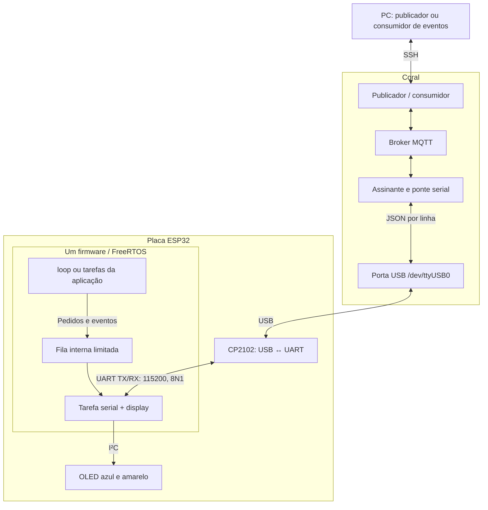

# Coral → ESP32 → OLED por MQTT

Publique uma mensagem no PC ou na Coral. Um assinante permanente na Coral encaminha o
texto ao ESP32 por USB. O OLED tem duas áreas independentes: azul em cima (128 × 48)
e amarela embaixo (128 × 16), com mensagens centralizadas em cada área.

```text
pub/ (PC ou Coral) → broker MQTT na Coral → sub/ (Coral) → USB → firmware (ESP32) → OLED
```

## Organização

```text
pub/
  mqtt.py             Publicador MQTT e API Python
  pc.py               Publicador do PC via SSH
  messages.py         Validação e nomes dos tópicos
  events.py           Consumidor de eventos espontâneos do ESP32
sub/
  subscriber.py       Assinante MQTT permanente na Coral
  serial_display.py   Comunicação serial com o ESP32
  firmware/
    coral_display/    Código Arduino e centralização do texto
  services/           Modelos de broker e serviços systemd
  build.sh            Compilação do firmware
tests/                Testes do protocolo, publicadores e posicionamento
```

O assinante MQTT roda **na Coral**, não no ESP32. O ESP32 recebe comandos pela serial.
O CP2102 faz a conversão USB ↔ UART (115200 baud, 8N1); comandos, confirmações e eventos
são JSON delimitado por uma quebra de linha. Não há MQTT no ESP32.
Outros programas podem publicar sem abrir ou disputar a porta USB.

## Uso rápido

Execute a partir da raiz deste repositório. A Coral precisa estar preparada conforme
[sub/README.md](sub/README.md), com broker, assinante e firmware instalados.

Na Coral, após entrar com `mdt shell` ou SSH (ativar o Conda `coral` no PC não abre essa sessão):

```sh
python3 -m pub --blue "Coral" --yellow "Pronta"
python3 -m pub --blue "Primeira" --blue "Segunda" --yellow "Online"
python3 -m pub "Coral"
python3 -m pub "Outra mensagem"
printf 'Linha 1\nLinha 2' | python3 -m pub -
python3 -m pub --clock
python3 -m pub --clear
python3 -m pub --status
```

No PC, usando SSH já configurado:

```sh
python3 -m pub.pc --blue "Coral" --yellow "Pronta"
python3 -m pub.pc --blue "Mensagem do PC" --yellow "Online" --host mendel@ENDERECO_DA_CORAL
```

O publicador do PC usa somente a biblioteca padrão Python e o comando `ssh`. O diretório
remoto padrão é `~/coral-esp32-display`; outro pode ser selecionado com `--remote-dir`.
Veja [pub/README.md](pub/README.md) para APIs Python e MQTT direto.

## Firmware com tarefas e eventos

Desde a versão 1.3, `display_service.cpp/.h` mantém uma tarefa FreeRTOS dedicada à
serial, ao OLED e ao RTC. O `coral_display.ino` fica livre para a aplicação: o exemplo
atual espera 10 segundos e publica `application_tick`, enquanto o display continua
recebendo comandos e alternando páginas. Substitua esse exemplo pelas suas funções.



Para acompanhar os eventos no PC, sem instalar Paho localmente:

```sh
python3 -m pub.pc --events
python3 -m pub.pc --events --count 2 --timeout 30
```

Na Coral: `python3 -m pub.events`. O tópico é `coral/esp32/events`, separado do estado
do display e sem retenção. Veja [sub/README.md](sub/README.md) para integrar funções ao
firmware, usar a fila e compartilhar o I²C, e [pub/README.md](pub/README.md) para consumir eventos.

## Comportamento

- Texto centralizado horizontal e verticalmente, com rotação de 180° para a montagem usada.
- Fonte automática por área; mensagens curtas ficam fixas. Textos longos são divididos
  em páginas de 3 segundos, sem atravessar a divisão entre azul e amarelo.
- Cada área aceita de 1 a 8 mensagens, alternadas em ciclo após suas páginas. A área
  com uma mensagem curta permanece fixa enquanto a outra alterna.
- Cada publicação substitui as duas áreas juntas. Área omitida na CLI fica vazia;
  texto simples usa somente a área azul. As cores são físicas, não selecionáveis por pixel.
- Até 1024 caracteres no total das duas áreas, após transliteração: `ação` aparece como `acao`; símbolos não
  disponíveis na fonte viram `?`.
- Última mensagem retida no broker e reaplicada após reconexão ou reset do ESP32.
- Pedidos locais pela fila podem alterar a tela até o próximo comando MQTT ou reconexão;
  a verificação periódica da Coral não desfaz uma alteração local no mesmo boot.
- Serial permanece aberta; atualizações do assinante não são gravadas na flash do ESP32.
- O publicador fornecido aguarda a confirmação do ESP32, além da confirmação do broker.
- O estado mais recente substitui mensagens pendentes; não é uma fila de alertas.

## Hardware

ESP32 DevKit com flash de 4 MB, USB CP2102, OLED SSD1306 128 × 64 I²C, SDA no GPIO21 e
SCL no GPIO22. OLED em `0x3C` ou `0x3D`; modo relógio com DS3231 em `0x68` no mesmo
barramento. OLED e RTC usam 3,3 V e terra comum.

Este é um **firmware novo**, dedicado às mensagens no OLED e à leitura do RTC. Não foi
baseado no firmware anteriormente instalado na placa e não implementa aquisição de áudio,
cartão SD, buzzer ou LED RGB. O backup da flash antiga fica fora deste repositório.

## Desenvolvimento e validação

Python 3.7 ou posterior. Para testes e assinante:

```sh
python3 -m pip install -r requirements.txt
python3 -m unittest discover -s tests -v
g++ -std=c++11 -Wall -Wextra -fsanitize=address,undefined tests/test_layout.cpp -o /tmp/test-layout
/tmp/test-layout
```

O código de origem foi validado no conjunto Coral + ESP32 + OLED: publicação, paginação,
ACK serial e recuperação após reiniciar broker e assinante. A centralização foi confirmada
visualmente. A organização em `pub/` e `sub/` também foi testada no hardware real.

Não estão incluídos binários, backups da flash, dados MQTT persistidos, credenciais,
ambientes Python ou ferramentas de terceiros.

### Validação da versão 1.3 — 11/11/2026

- 19 testes Python passaram no PC e na Coral; teste de layout C++ passou com sanitizadores.
- Firmware compilado e gravado no ESP32; 12 verificações da versão normal passaram.
- Sketch de teste confirmou a fila, evento `display_applied`, rejeição de JSON inválido
  e preservação de um comando UART fragmentado durante um pedido local de display.
- Teste de comunicação simultânea confirmou 27 comandos longos em 12 segundos e um
  evento espontâneo, sem reset; menor folga de pilha observada nesse teste: 8032 bytes.
- `python3 -m pub.pc --events --count 2 --timeout 30` recebeu eventos do `loopTask`
  pelo MQTT enquanto uma publicação de tela foi confirmada pela tarefa `coral-display`.
- A versão normal está instalada; o sketch temporário de teste não fica rodando.

### Validação da versão 1.2 — 10/11/2026

- 14 testes Python passaram no PC e na Coral.
- Testes de layout e alternância C++ passaram com AddressSanitizer e UndefinedBehaviorSanitizer.
- Firmware compilado, gravado e verificado no ESP32; 11 verificações de hardware passaram.
- Publicação pelo PC confirmou `blue: ["Coral"]`, `yellow: ["Pronta"]`, `ok: true` e `oled: true`.
- As duas mensagens foram reaplicadas pelo MQTT após reiniciar o assinante.
- O serviço permanente da Coral executa agora o assinante deste repositório.

O teste `sub.test_hardware` cobre mensagens curtas fixas, alternância independente,
paginação nas duas áreas, limite total de 1024 caracteres, listas, persistência e
compatibilidade com texto simples, relógio e limpeza. Os testes C++ verificam que
nenhum glifo ultrapassa os limites da sua área. A identificação física das cores e a
aparência final exigem confirmação visual no módulo utilizado.

Os arquivos systemd fornecidos são modelos para instalação; ajuste caminhos e o
executável do broker ao ambiente de destino.
